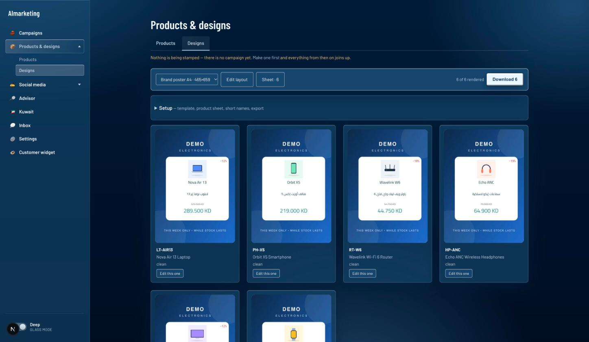
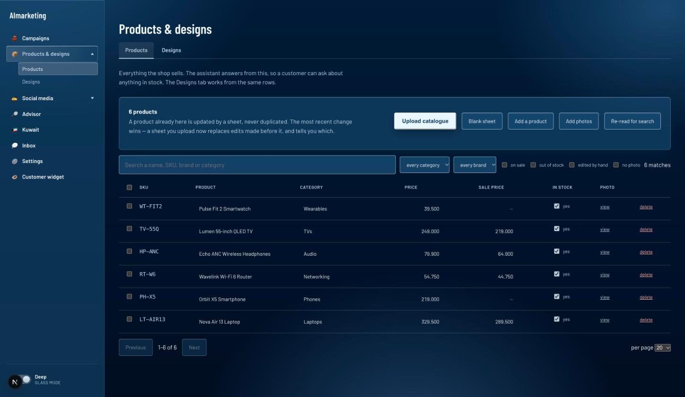
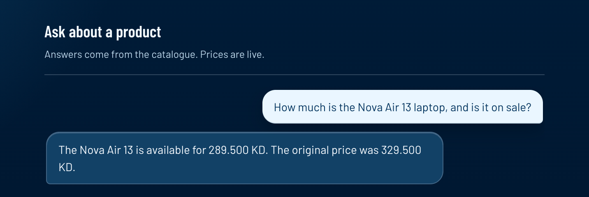

# AImarketing

One system connecting marketing and sales for a Kuwait retailer: fill brand
templates from an Excel product sheet, draft social copy from the same rows,
review drafts the team wrote, and answer customer product questions from the
catalog — with a campaign record tying the four together.

Everything runs on one machine. No catalog row, customer message, or
unpublished draft reaches an outside service.

## Highlights

- **Excel in, designs out.** An importer reads a messy product sheet and fills brand templates, producing SVG, PNG, JPG and PDF with correct Arabic shaping and right-to-left layout.
- **Local by default.** Models run on the same machine through Ollama; the app has a check that fails `npm test` if app code reaches the internet. Pointing a feature at a cloud model (OpenAI, Anthropic or Google) is opt-in, off by default, with keys encrypted at rest.
- **Grounded answers.** Customer questions are answered from the product catalogue with retrieval over `real[]` embeddings, and cited facts are checked against the retrieved rows.
- **Decisions on record.** `docs/decisions.md` logs 100 design decisions, each with the alternative rejected and the condition that would reverse it.
- **Tested without a browser.** 26 runnable check scripts cover the importer, templates, layout, content guard, scheduling, Instagram publishing and the cloud-provider routing.

## Screenshots

Synthetic demo data (a made-up "Demo Electronics" shop), running fully locally.

**Designs.** One Excel sheet becomes a finished poster per product, with Arabic names, sale prices and discount labels laid out automatically.



**Catalogue.** The same rows live in Postgres, searchable, with stock, prices and photos.



**Customer assistant.** Answers come from the catalogue through a local model, so the price it quotes is the price in the database.



## Stack

TypeScript (about 20k lines), Next.js and React, Postgres 17 with pgvector in Docker, Ollama for local LLMs and embeddings, ExcelJS, resvg, HarfBuzz and bidi-js for Arabic text rendering, PDFKit, ONNX Runtime for background removal, Zod.

## Quick start

```sh
npm install
npm run db:up && npm run db:migrate
npm run demo:seed   # a demo template and a six-product sheet, no real brand assets needed
npm run dev        # http://localhost:3000
npm test           # runs every check script
```

Then open Products, upload `data/samples/demo-electronics.xlsx`, and open Designs. 
Real brand templates and product photos are supplied per retailer and are not in this repo. Model setup is under **Machine setup** below. Built by Farouk Nuseibeh as a solo project.

## Read first

| File | What it covers |
|---|---|
| `CLAUDE.md` | The rules. Read before writing any code |
| `docs/vision.md` | What this is for and what it will never do |
| `docs/architecture.md` | How it works, and why each choice over the alternative |
| `docs/decisions.md` | Append-only decision log with reversal conditions |
| `docs/db.md` | The database: what is in it, why it exists, and what cannot be changed later |
| `docs/demo-script.md` | The ten-minute walkthrough |
| `PLAN.md` | The full planning document this was built from |

## Machine setup

Postgres 17.11 is already installed and running via Homebrew.

```sh
brew install ollama && brew services start ollama
ollama pull bge-m3
ollama pull gemma-4-12b
ollama pull hf.co/mradermacher/Fanar-1-9B-Instruct-GGUF

```

The full catalogue runs in Docker, pinned and bound to loopback:

```sh
npm run db:up        # pgvector/pgvector:pg17 on 127.0.0.1:5432
npm run db:migrate   # once, and after any change to db/*.sql
```

Set `DB_PORT` and `DATABASE_URL` in `.env` if 5432 is already taken.

pgvector ships in the image, unused for now: vectors are a `real[]` column and
cosine runs in TypeScript, which is microseconds at a few thousand rows. Turn it
on when the corpus reaches thousands — `CREATE EXTENSION vector`, an `ALTER`, and
a backfill from the column that already holds the floats.

The image tag is pinned, which is what keeps CLAUDE.md's warning about Postgres
18 from mattering.

Resident model budget is 12–15 GB, not 24. A dense 27B loads on a quiet machine
and does not survive a demo.

## The product sheet

Marketing does not need to guess at column names. Serve the app and hand them
`http://localhost:3000/api/template` — a blank sheet whose columns are the exact
ones the importer reads, with two example rows to delete and a second page
explaining each field, the SKU rule, and why prices carry three decimals.

`scripts/test-template.mjs` asserts the template still round-trips through the
parser, so the two cannot drift apart silently.

## Before writing code

Six things, none of them code, and two of them can delete work:

1. Get the real Excel, product images, and brand templates onto this machine.
2. Ask the brand-font licensor about **outlining**, not only embedding.
3. Collect 30–50 of the best past Arabic posts — the source of Kuwaiti voice.
4. **Export the last 100 posts' insights and check captions come out joined to
   reach.** If they do not, the advisor is not built in its planned form.
5. Check the sheet for an accessory or bundle column.
6. Measure the baseline: how long does producing 50 product posts take today?
   It stops being measurable once the manual process stops.

## Status

The template pillar works end to end: product sheet in, finished designs out, in
SVG, PNG, JPG and PDF. See **`HANDOFF.md`** for current state, open problems, and
what is still needed.
